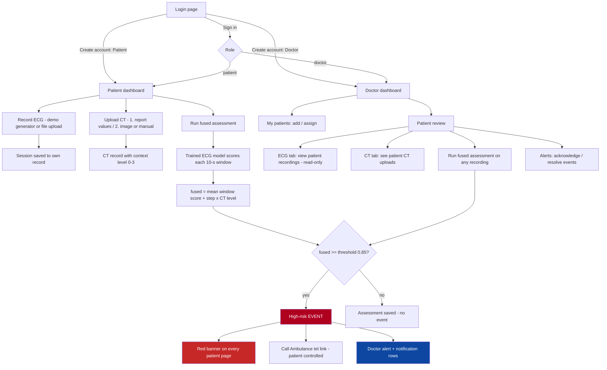

# VitalsFusion AI - Two-Role (Doctor / Patient) Emergency System

Offline-first Streamlit prototype that fuses a lead-II ECG CNN-LSTM score with
radiology-report CT features. This version adds exactly **two application
roles - Doctor and Patient** - with authentication, enforced patient-level
access control, and a patient-controlled ambulance-call emergency workflow.

> Non-diagnostic research prototype. Nothing here is a diagnosis or a
> prediction of a heart attack. A low score never rules out a heart attack.
> Patients are told to seek emergency care for concerning symptoms regardless
> of any AI output.

## What is preserved from the original prototype

| Original | Where it lives now |
|---|---|
| ECG CNN-LSTM model (NumPy runner) | `ecg_model.py` (unchanged) |
| CT radiology-report features | `ct_features.py` (unchanged) |
| Late-fusion layer (ECG + CT) | `fusion.py` - unchanged rules plus `fused_risk_score()` for the emergency threshold |
| CT image experiment (optional) | Assessment lab, "Experimental: CT images" tab (`ct_image_model.py` optional) |
| Patient/case history tables | Now persistent: `ct_records`, `ai_assessments`, `ecg_sessions` in SQLite |
| Original 3-tab fusion UI | `assessment_lab.py` (doctor Assessment lab tab) |
| Offline-first operation | SQLite + stdlib hashing + local inference; remote channels optional and never faked |

Note on "late-fusion Transformer": the repository's fusion stage is the
transparent rule-based late-fusion layer in `fusion.py` (no Transformer
checkpoint is present in this repo). The fusion interface
(`fuse(scores, ct_level, cfg)`) is the single integration point if a learned
fusion model is added later.

## Roles

- **Doctor** - sees only assigned patients (unless broader access is
  *explicitly* granted). **Reviews the patient's ECG recordings** (patients
  record them on their own side; the doctor has no device/demo-generator
  controls) and **runs the fused ECG + CT assessment** on a chosen recording;
  sees the CT records the patient uploaded (report values or image/manual
  level); reviews alerts, notes, contacts; assigns patients; generates
  reports; activates/deactivates assigned patient accounts.
- **Patient** - sees only their own records. **Records ECG** (demo generator
  or file upload - no hardware needed), **uploads their own CT records**
  (report values or image/manual level), runs the fused assessment, reviews
  history, keeps emergency-contact details, presses the Call Ambulance
  button, downloads their own reports. Their assigned doctor sees the ECG
  recordings and CT records they create.

There is no administrator, medical-staff or researcher role. Both roles can be
chosen on the **Create account** form on the login page (a doctor added that
way starts with assigned-patients-only access); the terminal tool
`setup_doctor.py` remains available for the first-doctor setup. CT upload and
ECG recording are shared modules used by both roles' access-checked paths
(`ct_upload.py`, `monitoring.py`). Every assessment result is displayed the
same way everywhere (`ui_common.fusion_panel`): ECG model mean score, CT
context level, fused risk score vs the threshold, with the fusion-rule
explanation.

## End-to-end flow



Access control (enforced in `db.py`, audited on denial): a patient only ever
touches their own record; a doctor only assigned patients (unless broader
access is granted). One active event per patient. Offline-first: SQLite +
local model inference; remote SMS is only attempted with a real gateway
module and is never simulated. Every assessment ends `completed` (with the
real score), `failed` or `unavailable` - never an invented low-risk result.

## Files

```
app.py               login + role router (register as doctor or patient)
auth.py              PBKDF2 hashing, login, lockout, session expiry
db.py                schema, migrations, ALL access-controlled queries
config.py            app_config.json + env overrides, offline detection
emergency.py         high-risk event workflow (save -> event -> notify -> ack)
notify.py            notification channels with honest delivery statuses
reports.py           CSV + dependency-free PDF reports
ui_common.py         global emergency banner, Call Ambulance widget, styles
assessment_core.py   shared ECG->fusion->risk pipeline
ct_upload.py         shared CT upload UI (report values / image / manual)
                     - used by patient dashboard AND doctor patient review
monitoring.py        shared ECG monitoring (demo generator / device / upload)
                     - patients monitor themselves, doctors monitor assigned
                       patients into the same patient record
assessment_lab.py    original 3-tab prototype + CT upload tab (choose
                     "1. Report values (radiology report)" or
                     "2. Image (DICOM series)")
patient_dashboard.py home, ECG recording (demo generator/upload), CT upload,
                     records, emergency, reports, profile
doctor_dashboard.py  patients, review tabs (view-only patient ECG browser +
                     fused ECG+CT assessment; CT records incl. patient
                     uploads; AI assessments tab with labelled TEST-simulation
                     controls), alerts, lab, account
migrate.py           database create/upgrade (idempotent)
setup_doctor.py      secure terminal doctor setup + account management CLI
test_*.py            automated tests (auth, access, emergency, pipeline, CT/ECG
                     sharing, registration roles, reports)
smoke_app.py         headless UI smoke test (streamlit AppTest)
app_config.json      configuration (edit thresholds / emergency number here)
```

## Quick start (local run)

```bat
cd ct part
pip install -r requirements.txt

:: 1. create / upgrade the database (idempotent)
python migrate.py

:: 2. create the FIRST doctor account (terminal only; prompts for password,
::    or use --generate-password to get a one-time random password)
python setup_doctor.py --email dr@clinic.pk --name "Dr Ayesha"

:: 3. put the trained models on the backend (never uploaded through the UI)
::    ecg_lead2_mi_model_v2.keras.zip   (next to app.py)
::    models/ResNet18_2.5D_best.pt      (CT image model; loaded once per process)
::    (missing weights are reported honestly - no predictions are invented)

:: 4. run
streamlit run app.py --server.maxUploadSize 1000
```

Open http://localhost:8501. Patients register with **Create patient account**
on the login page, or a doctor adds/assigns them from **My patients**.

### Database migration instructions

- `python migrate.py` creates `vitalsfusion.db` (WAL mode, foreign keys on)
  and applies schema migrations up to version `db.SCHEMA_VERSION`.
- It is safe to re-run any time; it prints schema version and account count.
- To move the database elsewhere, set `db_path` in `app_config.json` or the
  `VITALSFUSION_DB` environment variable (absolute path recommended).
- Before upgrading a live install, copy `vitalsfusion.db` (and its `-wal` /
  `-shm` siblings) as a backup; SQLite backups are file copies.
- Existing data lives only in this database - the original prototype stored
  everything in browser session memory, so there is nothing to import.

### Account / security management (terminal)

```bat
python setup_doctor.py --reset-password dr@clinic.pk --generate-password
python setup_doctor.py --deactivate dr@clinic.pk
python setup_doctor.py --activate dr@clinic.pk
python setup_doctor.py --create-patient ali@test.pk --name Ali
python setup_doctor.py --assign dr@clinic.pk ali@test.pk
python setup_doctor.py --email dr2@clinic.pk --grant-broad-access   --generate-password
```

Passwords: PBKDF2-HMAC-SHA256 (240k iterations, random 16-byte salt,
constant-time comparison). No default or hardcoded passwords exist anywhere;
sessions expire (idle + absolute) and logout clears server-side session state;
failed logins lock the account (5 tries / 15 min, configurable); accounts can
be deactivated; every login, denial and emergency action is written to
`audit_log`.

### Testing with fake data (inside the real app)

You do not need a separate demo system - test with synthetic data in your
real app, using your real accounts:

1. Create a doctor (`python setup_doctor.py ...`) and a patient (self-register
   or doctor adds them), as in normal use.
2. The patient records an ECG with the **demo generator** (Monitoring page ->
   "No device? Use the built-in demo generator") - a real saved ECG session
   with synthetic waveform data.
3. The doctor adds CT context on the patient's review tab (option 1 report
   values, option 2 image/manual level) - normal form, can use fictional
   numbers.
4. For the **emergency workflow without the model zip**: Patient review ->
   AI assessments tab -> **Test data (simulation)** expander:
   - **Simulate TEST high-risk assessment** - saves a completed assessment
     (fused 0.93, above the threshold) through the real pipeline: creates a
     real high-risk event, doctor notification rows, the patient's red
     banner and Call Ambulance button.
   - **Simulate TEST low-risk assessment** - completed assessment below the
     threshold; no event.
5. Every simulated record is tagged `TEST-SIMULATION (not a real model
   output)` and shown with a TEST warning in the doctor's
   Alerts/Assessments and the patient's Records. Nothing is overwritten
   (each run is a new row); one active event per patient still applies.
6. If you put `ecg_lead2_mi_model_v2.keras.zip` next to `app.py`, the
   assessment buttons run the real model on the synthetic (or real) ECG
   instead - same workflow, real scores.

## Emergency workflow

1. An assessment saves the **actual** model output (or an honest
   `failed`/`unavailable` status) to `ai_assessments`.
2. If `fused_score >= high_risk_threshold` (default **0.85**, subject to model
   validation - set it in `app_config.json`), a **unique** high-risk event is
   created. One active event per patient (partial UNIQUE index); Streamlit
   reruns and repeated evaluations reuse it instead of duplicating alerts.
3. The patient's dashboard shows a prominent red warning on **every page**
   with the measured heart rate, the model output, the threshold, and
   emergency-contact details.
4. **Call Ambulance** uses a configurable telephone link (`tel:1122` by
   default for the Lahore/Pakistan prototype). Pressing it records the
   patient's action and opens the device's calling app. The app states plainly
   that it cannot verify that a call was connected or that an ambulance was
   dispatched. Patients can call at any time - even with no AI assessment.
5. The assigned doctor sees the event in **Alerts**, with notification
   attempts and their statuses: `queued`, `sent`, `delivery_confirmed`
   (set when the doctor opens the alert), `failed`, `unavailable_offline`,
   `unavailable`.
6. Local dashboard notifications always work offline. A remote SMS channel is
   only attempted when configured **and** the device is online **and** a real
   gateway module (e.g. SIM800L 2G driver in `sms_gateway.py`) is installed;
   otherwise the attempt is recorded as `failed`/`unavailable_offline`.
   Delivery is never simulated.
7. The doctor acknowledges, resolves and annotates the event; patients see the
   updated status and can hide the big banner (the event stays open and a red
   strip plus the call button remain).

The fused risk score used by the threshold is
`mean(recent valid ECG window scores) + step_per_ct_level * CT level`
(capped at 1.0; `None` when no window passes the quality gate - a missing or
failed input never looks like a low-risk result).

### Emergency contact configuration

Each patient stores: contact name, relationship, contact number, configured
emergency service number (default 1122), voluntary location/address, and
accessibility notes. Patients edit their own details on the **Emergency**
page; the assigned doctor gets a read-only view. Location is **not** shared
with any ambulance service - there is no supported mechanism for that, and
the UI says so.

## Offline behaviour

- Login, patient records, ECG processing, local AI inference, assessment
  history and local emergency warnings all work offline (SQLite + local
  files).
- The Call Ambulance button uses the device's calling handler; without a
  compatible phone or calling app nothing happens and the caption explains
  that.
- Remote doctor notification and ambulance dispatch do **not** work offline
  and are reported as such (`unavailable_offline`).

## Configuration (`app_config.json`)

Key settings: `high_risk_threshold` (0.85), `emergency_service_number`
("1122"), session TTLs, lockout policy, fusion parameters, `remote_channel`
(`null` or `"sms"`), `offline_mode` (`auto`/`on`/`off`), `db_path`.
Environment overrides: `VITALSFUSION_DB`, `VITALSFUSION_CONFIG`,
`VITALSFUSION_OFFLINE`.

Optional integration hooks (both never required and never faked):

- `ecg_device.py` - `connect()`, `read(handle, n)`, `disconnect(handle)` for a
  real ECG device; without it the device is honestly shown as disconnected
  and the demo generator / file upload is used instead.
- `sms_gateway.py` - `send_doctor_alert(event) -> {"ok": bool, "confirmed":
  bool, "detail": str}` for a real modem (e.g. SIM800L; needs 2G coverage).

## Testing

```bat
python -m pytest -q          :: full automated suite
python smoke_app.py          :: headless UI flow test (Streamlit AppTest)
```

Recorded results on this machine (Python 3.13.5, Streamlit 1.60.0, trained
ECG model zip present, KERAS_BACKEND=torch for the parity check):

```
76 passed, 0 skipped
ALL SMOKE CHECKS PASSED
```

Without a Keras backend env var set, the Keras-parity test skips
(`75 passed, 1 skipped`).

Coverage highlights (synthetic test patients only, throwaway databases):

- doctor login, patient login (email **or** username), invalid credentials,
  identical failure message for wrong password vs unknown user
- account lockout after max failures; deactivated accounts blocked
- session expiry (absolute + idle); viewer rebuilt from DB, not session claims
- only two roles allowed; patients cannot change role/privilege fields
- patient reads only their own records; another patient's id is denied and
  audited (`access_denied`)
- doctor sees only assigned patients; assignment/revoke; explicit broader
  access grant required for wider access
- patient blocked from doctor entry points (alerts list, notes, event status,
  assignment)
- high-risk event created exactly at threshold; none below; none for
  failed/unavailable assessments (no invented low-risk result)
- duplicate-alert prevention: reruns and new assessments reuse the one active
  event; new event allowed after resolution
- notification statuses: local `sent`, unconfigured remote `unavailable`,
  offline `unavailable_offline`, missing gateway `failed`, doctor open ->
  `delivery_confirmed`
- Call Ambulance action recorded only for the patient's own event; doctor and
  other patients denied
- doctor acknowledge/resolve/notes with notification confirmation
- patient dismissal hides the banner but the event stays open for the doctor
- record persistence across simulated application restart (reopen DB)
- TEST simulation: labelled high-risk assessment raises a real event with
  local notification rows (fused 0.93 vs threshold); dedup keeps one active
  event on repeat runs while each run adds an assessment row; low-risk
  simulation (0.42) completes without an event; patient isolation (other
  patients unaffected); unassigned doctor denied and audited; unknown kind
  rejected; synthetic-record badge flags TEST/DEMO tags but not real model
  names
- pipeline tests: no model -> `unavailable`; too-short/flat/empty signal ->
  `failed`; stub-model high score -> completed assessment + event; low score ->
  completed without event
- shared CT upload (both roles): patient saves on their own record, doctor
  saves on an assigned patient; another patient / unassigned doctor denied
- patient-recorded ECG visible to the assigned doctor (view + fused
  assessment path); another patient and unassigned doctors denied; new
  doctors from registration get assigned-patients-only access
- UI smoke: login page, doctor dashboard, patient review, patient home,
  Emergency page, monitoring start + real-model assessment (completed with a
  score when the model zip is present, honest `unavailable`/`failed` without
  it), invalid-credential error display, doctor self-registration via the
  login-page form and sign-in

## Honest limitations (by design)

- Browser `tel:` links only open a compatible calling application; the system
  never claims an ambulance was contacted or a call connected.
- SMS to a doctor's phone needs a real, configured channel; the SIM800L is a
  2G module and needs compatible cellular service. Nothing is simulated.
- The 0.85 fused-score threshold is a design parameter pending model
  validation; tune it on your validation data.
- A single-lead wearable ECG is not suitable for clinical-grade monitoring or
  ST-segment analysis (original disclaimer retained throughout the UI).
